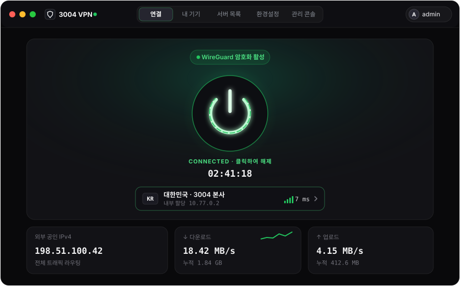
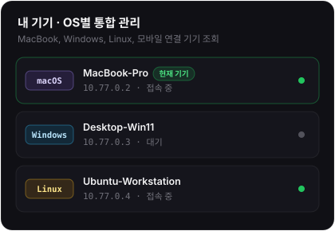
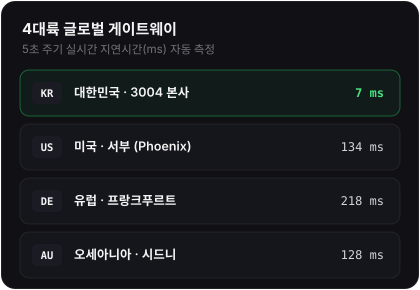
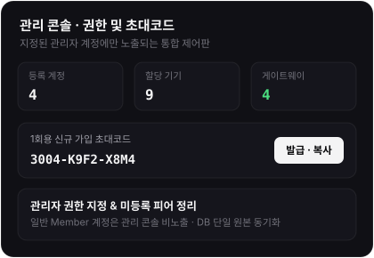

<p align="center">
  
</p>

<p align="center">
  <a href="https://github.com/kev208dev/3004-VPN/releases/latest">
    
  </a>&nbsp;&nbsp;
  <a href="https://github.com/kev208dev/3004-VPN/actions">
    
  </a>&nbsp;&nbsp;
  
</p>

<p align="center">
  <b>3004 VPN은 대한민국 본사 게이트웨이와 글로벌 클라우드(미국 · 유럽 · 오세아니아) 노드를 하나로 묶는 차세대 프라이빗 WireGuard VPN 클라이언트입니다. Windows, macOS, Android, iOS 어디서나 클릭 한 번으로 초저지연 암호화 터널에 연결하고 내 계정의 모든 기기를 통합 관리할 수 있습니다.</b>
</p>

&nbsp;

<p align="center">
  
</p>

<p align="center">
  &nbsp;
  &nbsp;
  
</p>

---

## 다운로드 및 설치 (Installation)

각 운영체제에 맞는 최신 자동 빌드 설치 파일을 아래 버튼에서 바로 내려받을 수 있습니다.

<p align="center">
  <a href="https://github.com/kev208dev/3004-VPN/releases/latest/download/3004-VPN-Setup-Windows.exe">
    
  </a>&nbsp;&nbsp;&nbsp;
  <a href="https://github.com/kev208dev/3004-VPN/releases/latest/download/3004-VPN-macOS.dmg">
    
  </a>&nbsp;&nbsp;&nbsp;
  <a href="https://github.com/kev208dev/3004-VPN/releases/latest/download/3004-VPN-Android.apk">
    
  </a>
</p>

- 전체 배포 아카이브 확인: [**GitHub Releases (Latest)**](https://github.com/kev208dev/3004-VPN/releases/latest)
- macOS 최초 1회 필수 패키지 설치:
  ```bash
  brew install wireguard-tools
  ```

---

## 어떻게 작동하나요? (How It Works)

**3004 VPN**은 번거로운 `.conf` 수동 파일 배포나 복잡한 터미널 명령어 없이, 중앙 **FastAPI 컨트롤 플레인**이 각 기기의 고유 식별자(`device_uid`)를 기준으로 키 쌍 생성·고정 내부 IP 할당·노드별 피어 동기화를 실시간으로 자동 수행합니다.

**수동 설정 파일이 필요 없나요?**

네. 처음 실행 시 3단계 온보딩(`서버 연결 → 계정 인증 → 시작 설정`)만 마치면, 이후에는 가운데 일렉트릭 전원 버튼 클릭 한 번으로 OS 네이티브 WireGuard 커널/서비스 터널이 즉시 연결됩니다. Windows의 반복 UAC 권한 창이나 macOS의 매번 뜨는 관리자 암호 입력도 최초 1회 권한 위임 헬퍼로 완전히 제거했습니다.

**다른 VPN 프로그램과 충돌하지 않나요?**

앱이 백그라운드에서 **Cloudflare WARP, Tailscale, OpenVPN** 등 타사 VPN 터널의 라우팅/DNS 선점을 실시간으로 감지하여 경고 배너를 띄워주며, 연결 시 자동으로 충돌 터널을 일시 해제하고 해제 후에는 기본 Wi-Fi DHCP DNS를 무결성 있게 복원합니다.

---

## 핵심 기능 (Core Features)

- **WebGL2 일렉트릭 원클릭 터널 스위치** — 대기(바이올렛), 협상 중(앰버), 암호화 활성(에메랄드) 상태를 실시간 전류 셰이더와 오로라 배경으로 직관적으로 표현합니다.
- **5초 주기 실시간 지연시간(Ping) & 트래픽 텔레메트리** — 게이트웨이별 실제 RTT(`ms`), 공인 IPv4 복호화 애니메이션, 실시간 다운로드/업로드 속도 및 누적 전송량을 표시합니다.
- **내 기기(My Devices) 통합 관리** — 내 ID로 로그인된 **MacBook(macOS), Windows, Linux, Android, iOS** 기기 목록과 현재 접속 여부를 한눈에 확인하고 원격으로 기기를 연결 해제할 수 있습니다.
- **4대륙 멀티 리전 아키텍처** — **대한민국 · 3004 본사** 노드를 중심으로 미국·유럽·오세아니아 클라우드 노드를 무중단으로 확장하고 원클릭으로 리전을 전환합니다.
- **권한 분리형 관리 콘솔 (Admin-Only)** — 지정된 `Administrator` 계정에만 관리 콘솔 탭이 노출되며, 1회용 초대코드(`3004-XXXX-XXXX`) 발급, 계정별 관리자 권한 부여, 기기 일시차단 및 미등록 수동 피어 일괄 정리를 제어합니다.

---

## 라우팅 및 네트워크 사양 (Tunnel Modes)

환경설정 탭에서 사용 목적에 따라 두 가지 라우팅 모드를 즉시 전환할 수 있습니다.

| 라우팅 모드 | 대상 트래픽 (`AllowedIPs`) | 권장 사용 시나리오 |
| :--- | :--- | :--- |
| **Full-Tunnel (기본값)** | 모든 외부 인터넷 + 내부망 (`0.0.0.0/0`) | 공용/학교/카페 Wi-Fi 보안 암호화, 외부에서 본사/해외 공인 IP로 전체 우회 접속 시 사용합니다. (`MTU 1380` + `TCPMSS` 자동 최적화 적용) |
| **Split-Tunnel (분할)** | VPN 서브넷 내부 통신만 (`10.77.0.0/24` 등) | 일반 웹 서핑과 영상 스트리밍은 현지 인터넷 속도를 그대로 유지하면서 내부 서버(SSH/NAS)에만 보안 접속할 때 적합합니다. |

---

## 서버 배포 및 글로벌 노드 확장 (Server Deployment)

### 1. 본사 컨트롤 플레인 배포 (Raspberry Pi / Linux)
```bash
git clone https://github.com/kev208dev/3004-VPN.git && cd 3004-VPN
sudo ./scripts/deploy-backend.sh --with-tunnel
```

### 2. 글로벌 원격 노드 1분 확장 (Oracle Cloud Ubuntu 22.04 / 24.04)
새 클라우드 VM에서 아래 스크립트 한 줄만 실행한 뒤 출력된 정보를 **관리 콘솔 → `+ 노드 등록`**에 입력하면 모든 클라이언트 앱에 즉시 반영됩니다.
```bash
git clone https://github.com/kev208dev/3004-VPN.git && cd 3004-VPN
sudo ./scripts/deploy-oracle-node.sh --node-id us-west-1 --region US --name "미국 · 서부" --subnet 10.79.0.0/24
```

---

## 프로젝트 구조 (Architecture)

```text
3004-VPN/
├── backend/                  # FastAPI 중앙 컨트롤 플레인 & 원격 노드 에이전트 (SQLite + JWT + Authoritative WG Sync)
├── desktop/                  # Windows (.exe) & macOS (.dmg/.app) 클라이언트 (Electron + React 18 + TypeScript + WebGL2)
├── mobile/                   # Android (.apk) & iOS 네이티브 앱 (Flutter + wireguard_flutter)
├── scripts/                  # 본사 백엔드 배포(deploy-backend.sh) 및 글로벌 노드 원클릭 설치(deploy-oracle-node.sh)
└── .github/workflows/        # main 푸시 시 테스트 검증 및 GitHub Releases 최신 설치 파일 자동 배포 CI
```

---

<p align="center">
  <sub>Built with precision using <b>WireGuard · FastAPI · Electron · React · WebGL2 · Flutter</b></sub>
</p>
