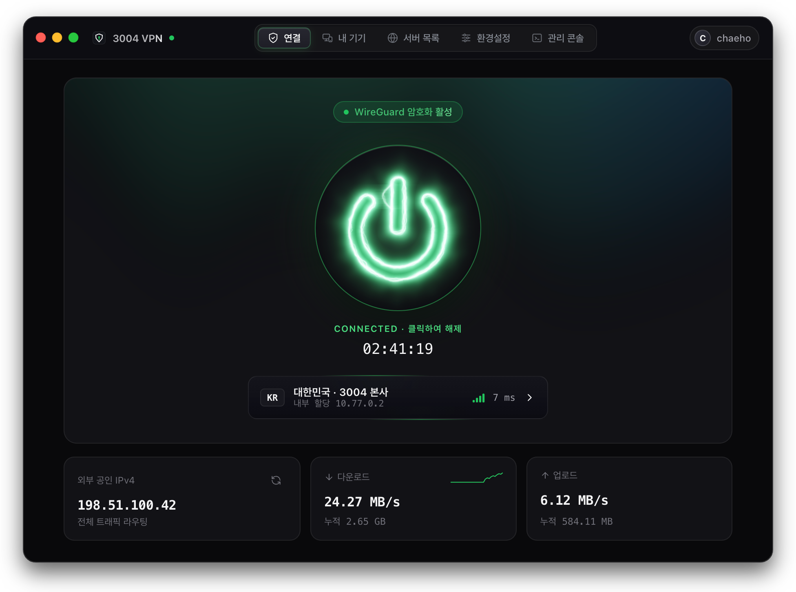
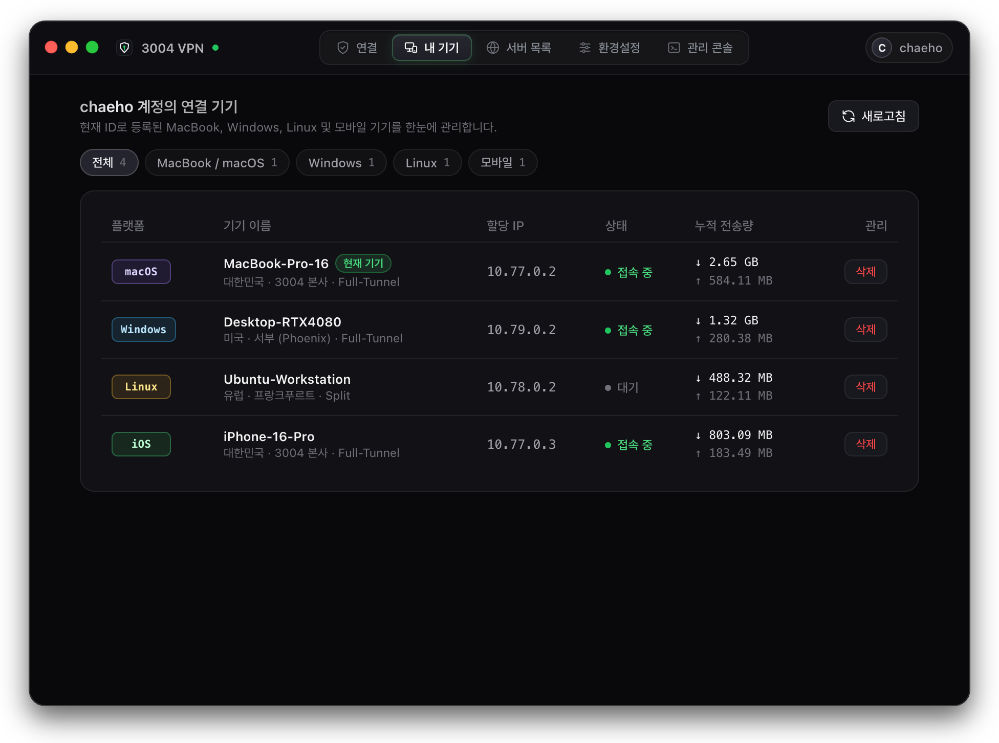
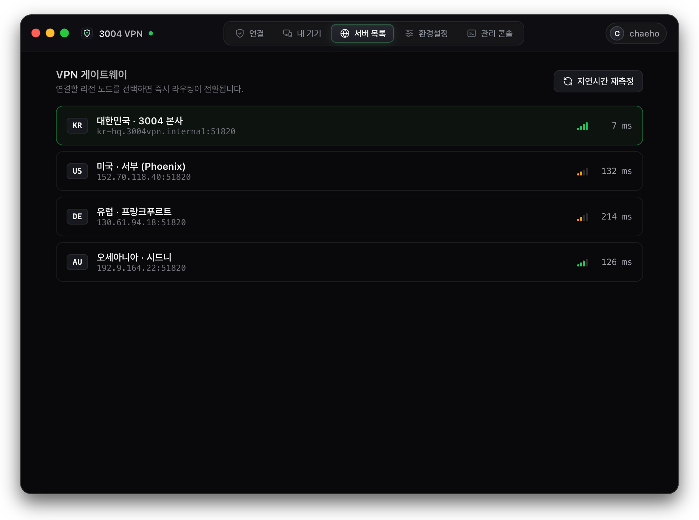
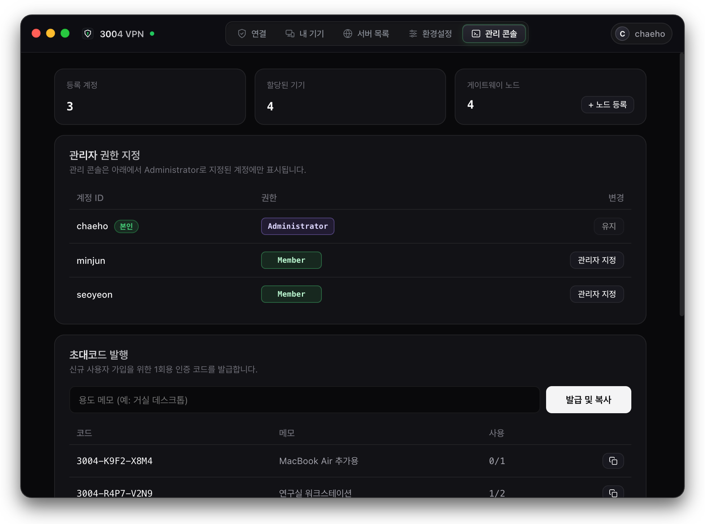

<p align="center">
  <picture>
    <source media="(prefers-color-scheme: dark)" srcset="docs/assets/logo-dark.png" />
    <source media="(prefers-color-scheme: light)" srcset="docs/assets/logo-light.png" />
    
  </picture>
</p>

<p align="center">
  <a href="https://github.com/kev208dev/3004-VPN/releases/latest">
    
  </a>&nbsp;&nbsp;&nbsp;
  <a href="https://github.com/kev208dev/3004-VPN/actions">
    
  </a>
</p>

<p align="center">
  <b>3004 VPN은 대한민국 본사 게이트웨이와 글로벌 클라우드 노드를 하나의 인터페이스로 연결하는 프라이빗 WireGuard 클라이언트입니다.<br/>복잡한 설정 파일 배포 없이 Windows, macOS, Android, iOS 어디서나 원클릭으로 암호화 터널을 구동합니다.</b>
</p>

&nbsp;

<p align="center">
  
</p>

<p align="center">
  
  
  
</p>

---

&nbsp;

## 다운로드 (Installation)

최신 릴리스 설치 파일은 아래에서 바로 내려받을 수 있습니다.

<p align="center">
  <a href="https://github.com/kev208dev/3004-VPN/releases/latest/download/3004-VPN-Setup-Windows.exe">
    
  </a>&nbsp;&nbsp;
  <a href="https://github.com/kev208dev/3004-VPN/releases/latest/download/3004-VPN-macOS.dmg">
    
  </a>&nbsp;&nbsp;
  <a href="https://github.com/kev208dev/3004-VPN/releases/latest/download/3004-VPN-Android.apk">
    
  </a>
</p>

macOS에서 처음 사용하는 경우 터널 드라이버를 1회 설치합니다:

```bash
brew install wireguard-tools
```

&nbsp;

## 작동 구조 (How It Works)

**수동 `.conf` 파일 관리가 전혀 필요 없는 구조**

기존 WireGuard 환경은 기기를 추가할 때마다 서버에 SSH로 접속해 키를 만들고 `.conf` 파일을 수동으로 옮겨야 했습니다. **3004 VPN**은 중앙 컨트롤 플레인(`FastAPI + SQLite`)이 기기별 고유 키 생성, 고정 내부 IP 할당, 커널 피어 동기화를 모두 자동으로 처리합니다.

**최초 1회 권한 위임으로 무중단 원클릭 연결**

Windows에서는 서비스 등록 및 예약 작업(`HIGHEST`)을 통해 매번 뜨던 UAC 권한 창을 없앴고, macOS에서는 최소 권한 헬퍼(`/usr/local/libexec/vpn3004-helper`)를 최초 1회만 등록해 이후 암호 입력 없이 즉시 연결·해제됩니다.

**네트워크 무결성 보호 및 타사 VPN 충돌 감지**

**Cloudflare WARP, Tailscale, OpenVPN** 등 타사 터널이 켜져 있으면 실시간으로 감지해 알려주며, 연결 시 충돌 터널을 자동 일시 해제합니다. 연결 해제 시에는 Wi-Fi DNS와 라우팅 테이블을 기본 DHCP 상태로 깨끗하게 복원합니다.

&nbsp;

## 주요 기능 (Features)

- **실시간 전류 셰이더 전원 스위치** — 대기, 협상, 암호화 활성 상태를 WebGL2 전류 아크와 오로라 광원으로 표현
- **5초 주기 지연시간(RTT) 및 속도 측정** — 선택된 게이트웨이의 실시간 핑(`ms`), 외부 공인 IPv4, 송수신 대역폭 표시
- **내 기기(My Devices) 조회** — 내 계정으로 등록된 macOS, Windows, Linux, iOS, Android 기기의 접속 상태 확인 및 원격 해제
- **4대륙 멀티 노드 확장** — 대한민국 본사 노드를 중심으로 북미·유럽·오세아니아 클라우드 노드를 코드 수정 없이 실시간 추가
- **권한 분리형 관리 콘솔** — 지정된 `Administrator` 계정에만 관리 콘솔을 노출하며, 1회용 초대코드 발급·권한 변경·미등록 피어 일괄 정리를 지원

&nbsp;

## 라우팅 모드 (Tunnel Modes)

| 모드 | 라우팅 범위 (`AllowedIPs`) | 설명 |
| :--- | :--- | :--- |
| **Full-Tunnel** | 전체 트래픽 (`0.0.0.0/0`) | 모든 외부 인터넷 통신을 선택한 국가 게이트웨이의 공인 IP로 암호화 우회합니다. (`MTU 1380` 및 `TCPMSS` 자동 클램핑 적용) |
| **Split-Tunnel** | 내부 서브넷 전용 (`10.77.0.0/24` 등) | 일반 웹 트래픽은 로컬 회선을 그대로 유지하면서 본사/클라우드 내부망 자원에만 보안 접속합니다. |

&nbsp;

## 서버 배포 및 노드 확장 (Deployment)

**본사 컨트롤 플레인 구동**

```bash
git clone https://github.com/kev208dev/3004-VPN.git && cd 3004-VPN
sudo ./scripts/deploy-backend.sh --with-tunnel
```

**글로벌 클라우드 원격 노드 추가 (Ubuntu 22.04 / 24.04)**

```bash
git clone https://github.com/kev208dev/3004-VPN.git && cd 3004-VPN
sudo ./scripts/deploy-oracle-node.sh --node-id us-west-1 --region US --name "미국 · 서부" --subnet 10.79.0.0/24
```

---

<p align="center">
  <sub>3004 VPN · Powered by WireGuard, FastAPI, Electron, WebGL2 &amp; Flutter</sub>
</p>
